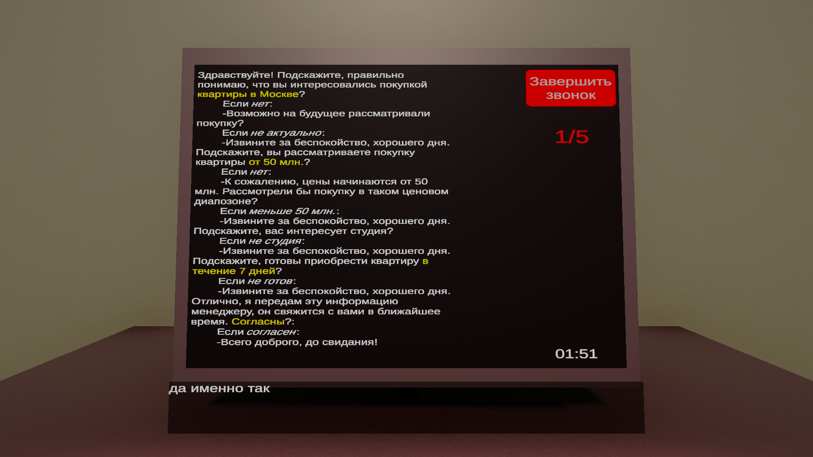

# Call Center Simulator (Voice AI)

Клиент-серверный симулятор колл-центра, где игрок общается с ИИ-клиентом голосом

## Стек технологий
- **Backend:** Python, FastAPI, WebSockets, PostgreSQL, Vosk(распознавание речи), GigaChat API(нейросеть)
- **Frontend:** Unity (C#)

## Как запустить сервер
1. Перейдите в папку `server`
2. Установите зависимости: `pip install -r requirements.txt`
3. Создайте файл `.env`(по примеру `.env.example`) и вставьте свои ключи от GigaChat
4. Запустите: `uvicorn main:app --host 0.0.0.0`

## Как запустить игру
1. Скачайте билд по ссылке [https://disk.yandex.ru/d/8t2p0Dm7imjoCw]
2. Запустите `exe` (сервер должен быть запущен)

